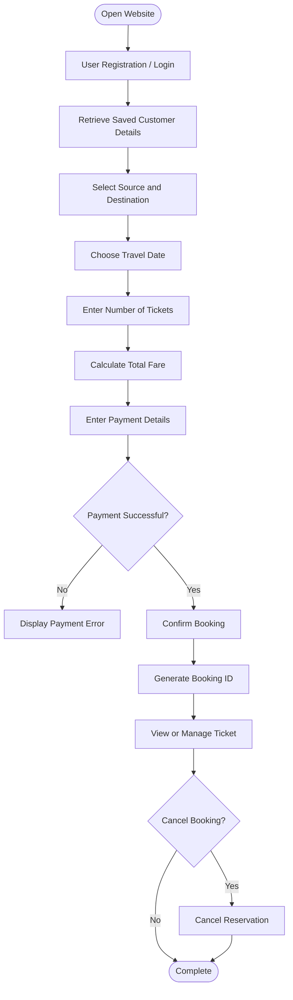
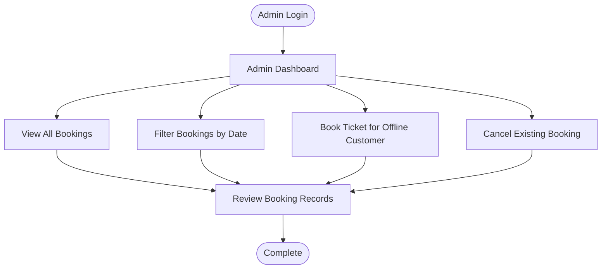
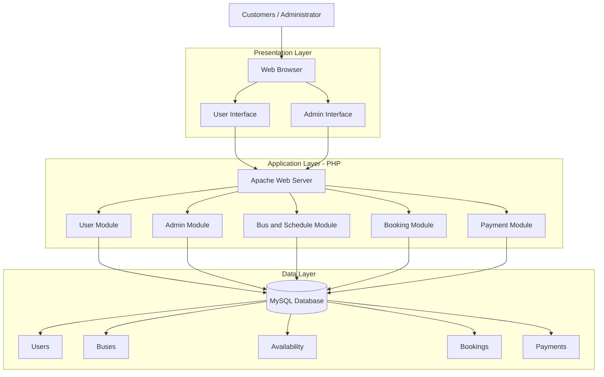
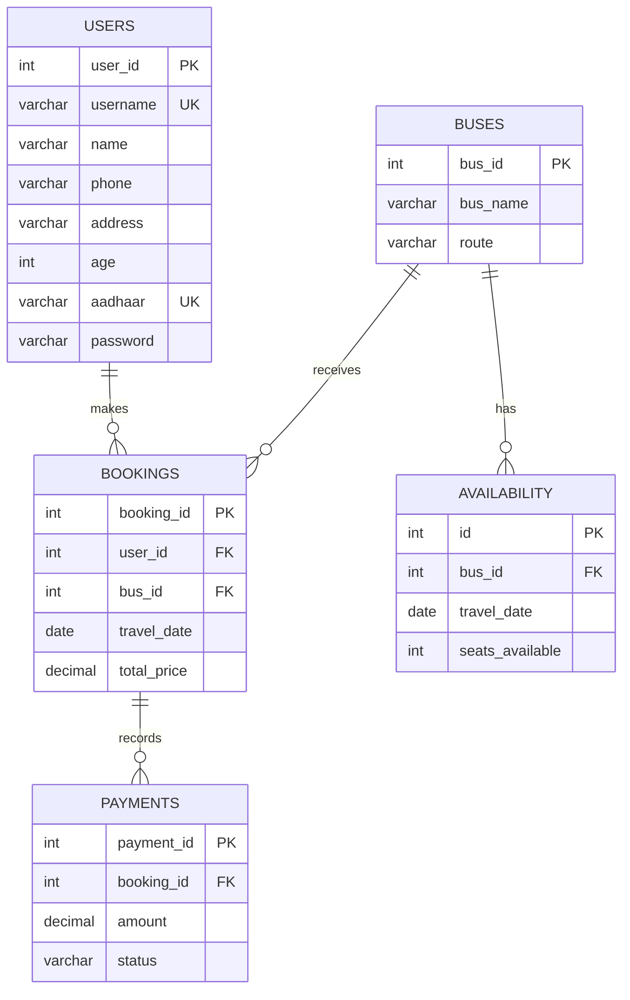

# 🚌 Your BUS — Online Bus Ticket Booking System

\<p align="center">
&#x20; \
&#x20; \
&#x20; \
&#x20; \
&#x20; \
\</p>

\<p align="center">
&#x20; \<strong>Travel Made Simple. Book Tickets with Confidence.\</strong>
&#x20; \<br/>\<br/>
&#x20; A web-based bus ticket reservation system that simplifies online bookings, customer management, ticket cancellation, and administrative operations.
\</p>

\<p align="center">
&#x20; \<strong>🎟️ Book Tickets\</strong> &nbsp; • &nbsp;
&#x20; \<strong>🔎 Track Bookings\</strong> &nbsp; • &nbsp;
&#x20; \<strong>❌ Cancel Reservations\</strong> &nbsp; • &nbsp;
&#x20; \<strong>📊 Manage Operations\</strong>
\</p>

---

## 📌 Project Overview

**Your BUS** is a web-based bus ticket booking application developed using PHP, HTML, CSS, and MySQL.

The system digitizes the traditional bus reservation process by allowing customers to register once, securely log in, search available routes, book tickets, complete the payment step, view booking details, and cancel reservations.

It provides two distinct access levels:

- **User:** Manage personal details, book tickets, view reservations, and cancel bookings.
- **Administrator:** Monitor all bookings, generate booking reports, and manage reservations, including bookings for offline customers.

Customer information and reservation records are maintained in a MySQL database, reducing repetitive data entry and simplifying booking management.

### Project Objectives

- Digitize the traditional bus ticket reservation process.
- Provide a convenient online booking interface.
- Maintain customer information for repeat bookings.
- Automate fare calculation based on route and ticket quantity.
- Provide booking lookup and cancellation functionality.
- Give administrators centralized booking management.
- Maintain relational data integrity using MySQL.

## ✨ Key Features

| Module               | Functionality                                                |
| -------------------- | ------------------------------------------------------------ |
| User Registration    | Register with a unique username and save customer details    |
| User Authentication  | Login and retrieve previously saved information              |
| Bus Booking          | Select source, destination, travel date, and ticket quantity |
| Fare Calculation     | Calculate total fare automatically                           |
| Payment Step         | Validate payment details before booking confirmation         |
| Booking Confirmation | Generate a booking ID after successful payment               |
| Ticket Lookup        | Retrieve booking details using the booking ID                |
| Ticket Cancellation  | Allow users to cancel their own bookings                     |
| Admin Dashboard      | Review all customer bookings                                 |
| Booking Reports      | Filter booking records by travel date                        |
| Offline Reservations | Book tickets for walk-in customers                           |
| Data Integrity       | Use database relationships and constraints                   |

## 🔄 Complete Application Workflow

Your BUS provides separate workflows for customers and administrators.

### User Booking Workflow



### Administrator Workflow



## 🏗️ System Architecture

The application follows a PHP-based client-server architecture. The browser communicates with PHP pages served through Apache, while PHP handles application logic and database operations.



### Architecture Components

| Layer             | Technology | Responsibility                                    |
| ----------------- | ---------- | ------------------------------------------------- |
| Presentation      | HTML, CSS  | User and administrator interfaces                 |
| Web Server        | Apache     | Serve the PHP application                         |
| Backend           | PHP        | Application logic and request processing          |
| Database          | MySQL      | Store customer, bus, booking, and payment records |
| Local Environment | XAMPP      | Run Apache, PHP, and MySQL locally                |

## 🧩 Application Modules

The application is organized into five primary functional modules.

### 1. User Management Module

Handles customer registration, authentication, and profile information.

- New user registration.
- Unique username validation.
- Login and retrieval of saved customer details.
- Customer information validation.
- User-specific booking access.

### 2. Administrator Module

Provides centralized control over reservation records.

- View all bookings.
- Filter bookings by travel date.
- Create bookings for offline customers.
- Cancel existing bookings.
- Review booking information.

### 3. Bus & Schedule Module

Handles bus and travel availability information.

- Bus identification and details.
- Source and destination routes.
- Travel dates.
- Seat availability for individual buses and dates.

### 4. Booking Module

Manages the customer reservation lifecycle.

- Select a route.
- Choose a travel date.
- Enter ticket quantity.
- Calculate the booking amount.
- Generate a booking ID.
- View and cancel reservations.

### 5. Payment Module

Handles the payment step associated with reservations.

- Validate payment card details.
- Check card expiry information.
- Calculate the payable amount.
- Store payment amount and status.
- Confirm booking after successful payment validation.

*The supplied project description documents payment validation but does not establish integration with a real payment gateway.*

## 🗄️ Database Design

The application uses MySQL with five principal relational tables.

### Database Tables

| Table        | Primary Key  | Important Fields                             | Relationship                               |
| ------------ | ------------ | -------------------------------------------- | ------------------------------------------ |
| Users        | `user_id`    | username, name, phone, address, age, Aadhaar | One-to-many with Bookings                  |
| Buses        | `bus_id`     | bus_name, route                              | One-to-many with Bookings and Availability |
| Availability | `id`         | bus_id, travel_date, seats_available         | References Buses                           |
| Bookings     | `booking_id` | user_id, bus_id, travel_date, total_price    | References Users and Buses                 |
| Payments     | `payment_id` | booking_id, amount, status                   | References Bookings                        |

### Database Relationship Diagram



*The diagram represents the documented logical relationships. Confirm the actual SQL schema for exact column types and foreign-key cardinalities.*

## 📦 Customer Data Model

The customer registration module stores the following information:

| Field         | Data Type | Size | Description                    |
| ------------- | --------- | ---: | ------------------------------ |
| `user_id`     | Number    |   11 | Customer ID and primary key    |
| `name`        | String    |  100 | Customer name                  |
| `phone`       | Number    |   10 | Customer contact number        |
| `address`     | String    |  255 | Customer address               |
| `age`         | Number    |   11 | Customer age                   |
| `pincode`     | Number    |    6 | Residential PIN code           |
| `city`        | String    |  100 | Customer city                  |
| `aadhaar`     | Number    |   12 | Aadhaar identification number  |
| `username`    | String    |  100 | Unique login username          |
| `password`    | String    |  255 | Stored password representation |
| `country`     | String    |  100 | Customer country               |
| `travel_date` | Date      |    — | Selected travel date           |

*The travel date is a booking-related field in the supplied data description; its exact placement in the database should be checked against the actual SQL schema.*

## ✅ Input Validation & Data Integrity

The application performs validation at important stages of registration and booking.

| Area              | Validation                                       |
| ----------------- | ------------------------------------------------ |
| Registration      | Unique username                                  |
| Aadhaar           | Unique 12-digit value                            |
| Phone Number      | 10-digit number                                  |
| Age               | Customer age validation                          |
| Payment           | Card details and expiry validation               |
| Seat Availability | Availability tracked per bus and travel date     |
| Database          | Unique constraints and foreign-key relationships |

These checks help maintain consistent customer and booking information.

## 💰 Fare Calculation & Booking Logic

The total ticket price is calculated automatically using the selected route and ticket quantity.

### Pricing Formula

[
\text{Total Fare} = \text{Route Fare} \times \text{Number of Tickets}
]

### Booking Process

1. Customer selects a source and destination.
2. Customer chooses a travel date.
3. Customer enters the number of tickets.
4. The application calculates the total fare.
5. Payment details are validated.
6. After successful payment validation, the booking is confirmed.
7. Booking and payment information are stored in MySQL.
8. A booking ID is generated for ticket lookup.

## 👥 User Roles & Permissions

The application supports two access levels.

| Capability              |                 User                 |        Administrator       |
| ----------------------- | :----------------------------------: | :------------------------: |
| Register an account     | \<badge color="success">Yes\</badge> |             No             |
| Login                   |                  Yes                 |             Yes            |
| Book tickets            |                  Yes                 | Yes, for offline customers |
| View personal bookings  |                  Yes                 |             Yes            |
| View all bookings       |                  No                  |             Yes            |
| Filter bookings by date |                  No                  |             Yes            |
| Cancel own booking      |                  Yes                 |             Yes            |
| Cancel other bookings   |                  No                  |             Yes            |

### User Account

Customers can register with a unique username and use their account to manage reservations.

### Administrator Account

The administrator uses the configured fixed credentials described by the project. This authentication approach should be upgraded before real-world deployment.

## 🖥️ Screenshots

The following screenshots showcase the application interface.

\<p align="center">
&#x20; \
&#x20; \
\</p>

## 🛠️ Technology Stack

| Category          | Technology | Purpose                        |
| ----------------- | ---------- | ------------------------------ |
| Frontend          | HTML5      | Page structure                 |
| Styling           | CSS3       | Layout and visual presentation |
| Backend           | PHP        | Server-side application logic  |
| Database          | MySQL      | Persistent application records |
| Web Server        | Apache     | Execute and serve PHP pages    |
| Local Environment | XAMPP      | Local development environment  |
| Code Editor       | Notepad++  | Source-code editing            |

### System Requirements

- XAMPP with Apache, PHP, and MySQL.
- A compatible web browser.
- Windows 10 or another compatible operating system.
- Basic local development environment.

## 🚀 Installation & Local Setup

Follow these steps to run Your BUS on your local computer.

### Prerequisites

Install [XAMPP](https://www.apachefriends.org/) with Apache and MySQL.

### Step 1 — Clone the Repository

```bash
git clone https://github.com/kamakshi-13/your-bus-booking-system.git
```

### Step 2 — Move the Project into XAMPP

Copy the project folder into the XAMPP web directory.

**Windows:**

```text
C:\xampp\htdocs\your-bus-booking-system
```

### Step 3 — Start Apache and MySQL

1. Open XAMPP Control Panel.
2. Start **Apache**.
3. Start **MySQL**.

### Step 4 — Create the Database

Open phpMyAdmin:

```text
http://localhost/phpmyadmin
```

1. Create a new MySQL database.
2. Locate the SQL file supplied with the project.
3. Import the SQL file into the newly created database.
4. Confirm that the required tables have been created.

### Step 5 — Configure Database Connection

Open the project's database configuration file.

Update the connection settings:

```php
$host = "localhost";
$username = "root";
$password = "";
$database = "your_database_name";
```

*Use the actual database name and connection variable structure expected by your project.*

### Step 6 — Run the Application

Open your browser:

```text
http://localhost/your-bus-booking-system
```

Your BUS should now be accessible through the local Apache server.

## 📄 Project Documentation

The project includes analysis and system-design documentation covering:

- Entity Relationship Diagram (ER Diagram).
- Data Flow Diagram (Level 0).
- Data Flow Diagram (Level 1) for User and Admin.
- Use Case Diagram.
- Data Dictionary.
- Modularization details.
- Database constraints.

These documents describe the application's structure, business processes, data relationships, and user interactions.

## ⚠️ Limitations & Security Considerations

The current project is a local PHP/MySQL implementation and has several areas that should be improved before production use.

| Area                  | Current Limitation                               | Recommended Improvement                           |
| --------------------- | ------------------------------------------------ | ------------------------------------------------- |
| Admin Authentication  | Fixed administrator credentials                  | Implement secure administrator account management |
| Sensitive Information | Aadhaar information requires stronger protection | Encrypt sensitive data and restrict access        |
| Password Security     | Storage implementation needs verification        | Use PHP `password_hash()` and `password_verify()` |
| Payments              | No confirmed real payment gateway integration    | Integrate a trusted payment provider              |
| Notifications         | No email or SMS confirmation                     | Add booking notifications                         |
| Hosting               | Local XAMPP setup                                | Deploy to a production hosting environment        |
| Seat Management       | Availability is tracked per bus and date         | Add transaction-safe seat reservation             |
| Interface             | Mobile responsiveness needs improvement          | Implement responsive layouts                      |

**Important:** Do not use real Aadhaar or payment-card information in the current application without appropriate security, privacy, and compliance improvements.

## 🔮 Future Enhancements

Potential improvements for future versions include:

- [ ] Secure administrator authentication.
- [ ] Real payment gateway integration.
- [ ] Interactive bus seat selection.
- [ ] PDF ticket and e-ticket generation.
- [ ] Email booking confirmations.
- [ ] SMS booking notifications.
- [ ] Bus and route management from the admin panel.
- [ ] Improved cancellation and refund workflows.
- [ ] Fully responsive mobile interface.
- [ ] Live deployment.
- [ ] Booking analytics and revenue reports.
- [ ] Improved security and database optimization.

*These are proposed enhancements, not claims about currently implemented functionality.*

## 🎓 Learning Outcomes

This project demonstrates practical understanding of:

- PHP server-side development.
- HTML and CSS interface development.
- MySQL database design and management.
- User registration and authentication.
- CRUD operations.
- Relational database relationships.
- Foreign keys and unique constraints.
- Form validation.
- Ticket booking workflows.
- Fare calculation.
- Administrative dashboard functionality.
- Local application deployment using XAMPP.

---

## 👩‍💻 Author

**Kamakshi Arora**

Project: **Your BUS — Online Bus Ticket Booking System**

A PHP and MySQL-based web application developed to simplify bus ticket reservations and demonstrate practical implementation of database-driven web development.

\<p align="center">   \<strong>🚌 YOUR BUS\</strong>   \<br/>   \<em>Plan Your Journey. Book Your Seat. Travel with Ease.\</em>   \<br/>\<br/>   \<sub>Designed and developed by Kamakshi Arora.\</sub> \</p>
